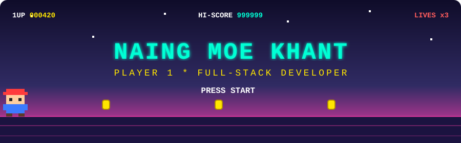

<p align="center">
  
</p>

<p align="center">
  
  
</p>

## 🎮 Player Profile

```text
┌────────────────────────────────────────────────┐
│  NAME    : Naing Moe Khant                     │
│  CLASS   : Full-Stack Web Developer            │
│  BASE    : Yangon, Myanmar                     │
│  GUILD   : UMG Myanmar (09/2025 - Present)     │
│  XP      : 2+ years building production apps   │
│  LANGUAGE: English, Burmese                    │
│  STATUS  : ● ONLINE  (Open to new work)        │
└────────────────────────────────────────────────┘
```

<p align="center">
  <a href="https://naingmoekhant.vercel.app/">
    
  </a>
</p>

<p align="center">
  
</p>

## ⚔️ Boss Battles (Featured Projects)

| 🏆 Quest | 📜 What I built | 🧰 Loot (Stack) |
|---|---|---|
| **WintKyats** | Money remittance system: KYC, blacklist screening, agent withdrawals, multi-stage finance approvals | React, Ant Design, Zustand, Laravel |
| **Shwe San Eain** | Hotel management: rooms, bookings, dynamic pricing, accounting, RBAC, reports | React, TypeScript, TanStack Query, Laravel, MySQL |
| **Z Collection** | Stock and POS system with variants, orders, delivery tracking, Excel export | React, Node.js, shadcn/ui, Zod |
| **Zewaka Nurse Appointment** | Healthcare appointment platform with localization | React, Node.js, React Hook Form |

> More on my [portfolio](https://naingmoekhant.vercel.app/), including Figma UI/UX concepts like a warehouse system and *Booking Myanmar*.

## 🎒 Inventory

<p align="center">
  
  
  
  
  
  
  <br/>
  
  
  
  
  <br/>
  
  
  
  
  <br/>
  
  
  
  
  
</p>

## 🏆 Achievements

<p align="center">
  
  
</p>

<p align="center">
  
</p>

## 📜 Quest Log (Career)

- [x] 🎓 **2018 – 2025:** B.C.Sc, University of Computer Studies (Mandalay)
- [x] ⚔️ **02/2024 – 07/2024:** Full Stack Web Developer, Nk Software House
- [x] ⚔️ **08/2024 – 07/2025:** Frontend Developer, MCodey
- [ ] 🔥 **09/2025 – Now:** Full Stack Web Developer, UMG Myanmar
- [ ] 👑 **Next boss:** your next great project

## 🐍 Arcade: Games Playing My Contributions

<p align="center">
  <picture>
    <source media="(prefers-color-scheme: dark)" srcset="https://raw.githubusercontent.com/Naingmoekhant0098/Naingmoekhant0098/output/github-snake-dark.svg" />
    <source media="(prefers-color-scheme: light)" srcset="https://raw.githubusercontent.com/Naingmoekhant0098/Naingmoekhant0098/output/github-snake.svg" />
    
  </picture>
</p>

<p align="center">
  <picture>
    <source media="(prefers-color-scheme: dark)" srcset="https://raw.githubusercontent.com/Naingmoekhant0098/Naingmoekhant0098/output/pacman-contribution-graph-dark.svg" />
    <source media="(prefers-color-scheme: light)" srcset="https://raw.githubusercontent.com/Naingmoekhant0098/Naingmoekhant0098/output/pacman-contribution-graph.svg" />
    
  </picture>
</p>

<p align="center">
  
  
  
</p>

## 🕹️ Play My Arcade (Free, In Your Browser)

<p align="center">
  <a href="https://Naingmoekhant0098.github.io/arcade/#snake"></a>
  <a href="https://Naingmoekhant0098.github.io/arcade/#runner"></a>
  <a href="https://Naingmoekhant0098.github.io/arcade/#breakout"></a>
  <a href="https://Naingmoekhant0098.github.io/arcade/#memory"></a>
</p>

## 🎒 Inventory

<p align="center">
  
  
  
  
  
  
  
</p>

## 🏆 Achievements

<p align="center">
  
  
</p>

<p align="center">
  
</p>

## 📜 Quest Log

- [x] Learn the fundamentals
- [x] Build first full-stack app
- [ ] **Current quest:** [your project here]
- [ ] Boss fight: ship something people use

## 💾 Save Point (Contact)

<p align="center">
  <a href="mailto:naingmoekhant098765@gmail.com"></a>
  <a href="https://naingmoekhant.vercel.app/"></a>
  <a href="https://naingmoekhant.vercel.app/cv.pdf"></a>
</p>

<p align="center"></p>
<p align="center"><b>GAME OVER? ...INSERT COIN TO CONTINUE 🪙</b></p>
